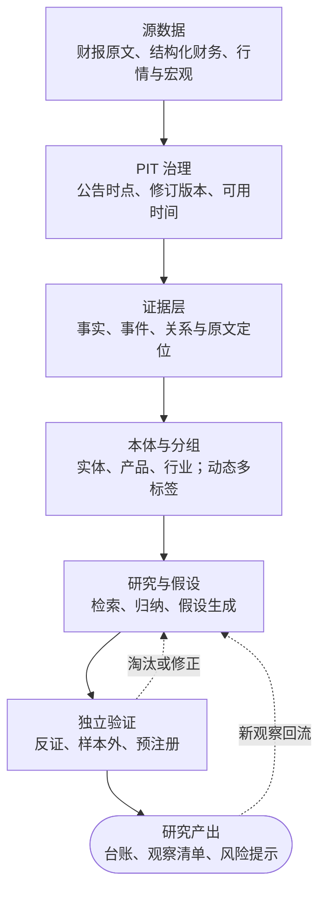
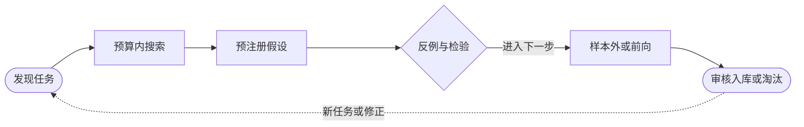

# 架构、研究闭环与对象定义

本文记录总体蓝图中的分层架构、持续研究闭环，以及数据对象与证据规则。这些是概念模型，不是已经落地的表结构，也不是可以运行的流水线。

总体定位、验证口径和演示样例见 [BLUEPRINT.md](BLUEPRINT.md)。阶段输入、输出、验收和否决见 [ROADMAP.md](ROADMAP.md)。入口见 [README.md](README.md)。

## 分层架构

上一层的输出是下一层的输入。Point-in-time（PIT，按公告可获得时间回放）约束贯穿全链。假设生成与独立验证分开：验证不与生成混在同一条流水线里既出题又打分。

源数据层只保存原文与结构化输入，不直接写研究结论。PIT 治理给每份文件、每个数字打上公告可获得时间、报告期或事项生效时间、录入时间，并保留修订版本，避免回放时误用后来才知道的信息。证据层把文本和表格变成可定位的事实、事件与关系，并区分公司声称、提取事实、推断与假设。

本体与分组层维护公司、产品、原料、客户类型等实体，以及可回放的动态多标签分组；官方行业只是分组视图之一。研究层在预算内检索与生成假设。验证层独立做反证、样本外和时间切割，不与生成混在同一条流水线里「既出题又打分」。产出层只出具研究台账、观察清单和风险提示，供人工审阅。

图中的实线是层与层的输入关系。两条虚线沿用原蓝图：「淘汰或修正」从独立验证回到研究与假设，「新观察回流」从研究产出回到研究与假设。评价口径、风险规则和权限不在这张图里被系统改写。

## 持续研究闭环

评价口径、风险规则与权限由人设定，系统不能自行改写。研究迭代更新的是假设、证据和结论版本，不是模型的训练、奖励或风控。

系统按发现任务工作，每轮搜索和假设试验都有数量预算，避免发现得越多越容易撞出假规律。提出假设时必须同时写清机制、适用条件、失效条件与检验方案，先预注册再看结果。同一问题允许并存相互竞争的假设，用统一口径比较，而不是只保留最会讲故事的那一个。

检验要主动找反例，并报告独立样本数——同一公司连续多期不能当成一堆独立证据。通过历史样本外检验的假设，可以进入纸面前向跟踪：在结果揭晓前先记录观察。入库须经人工审核，结论带版本；过时则标记淘汰，失败也留在台账里。

相关不等于因果。没有识别策略、也没有控制混杂时，只报告相关与时滞。经营上的判断，和股价是否已经反映，按 [研究问题](BLUEPRINT.md#questions) 分开记录。检验口径见 [验证与风控](BLUEPRINT.md#validation)。

图中的「进入下一步」沿用原蓝图的单条前进边。未通过的假设不另画原图没有的分支；它们在「审核入库或淘汰」中保留为失败，并可以经虚线成为新任务或修正。

## 数据对象与证据规则

下表是概念模型，不是已落地的表结构。每一条记录都要区分信息类型：公司声称、提取事实、推断、假设。置信度必须能对照历史命中率校准，禁止把「模型很肯定」当成高置信。未披露的客户或供应商身份保持未知，禁止推测填入。

| 对象 | 作用 | 关键约束 |
|---|---|---|
| `source` | 数据来源系统或库 | 名称、权限、更新方式 |
| `document` | 一份公告或财报文件 | 公司、类型、版本、`available_at` |
| `version` | 同一文件的修订 | 版本号、替代关系、生效时间 |
| `company` | 上市公司主体 | 代码、名称、存续区间 |
| `entity` | 产品、客户类型、原料、地区等 | 类型、别名、来源；未知身份不填 |
| `fact` | 可核对的陈述或数据点 | 类型、`loc`、币种单位、合并口径、时点 |
| `event` | 经营或披露事件 | 类型、时间、相关事实 |
| `relation` | 实体间关系 | 关系类型、方向、有效期、证据 |
| `exposure` | 共同暴露（原料、客户、汇率等） | 暴露对象、方向、依据 |
| `group` | 动态多标签分组 | 规则、as-of 快照、成员 |
| `hypothesis` | 待检验命题 | 机制、适用与失效条件、预注册方案 |
| `experiment` | 一次检验 | 样本、切分、预算编号 |
| `result` | 检验结果 | 支持、不支持或证据不足；反例；是否入库 |

证据规则：

- 证据定位 `loc`：页、段或原文锚点，能回到当页原文。
- 三个时间：公告可获得时间 `available_at`、报告期或事项生效时间、录入时间。回放只用前两者，不用录入时间冒充公告时间。
- 金额与口径：币种 `currency`、单位 `unit`、是否合并报表 `consolidated`，必须可对账。

`group` 按规则保存 as-of 成员快照，供历史回放。官方行业只是分组视图之一。`exposure` 的对象包括原料、客户、汇率等；未披露的客户或供应商身份保持未知。分组若使用了未来信息，或不能按时点回放，按 [Phase 3](ROADMAP.md#phase-3) 的否决条件处理。

`hypothesis` 在进入 `experiment` 之前完成预注册。`result` 允许「证据不足」，并保留不支持的结果。是否入库由人工审核决定。对象之间的这层顺序对应上面的研究闭环，不表示这些表已经建好。
