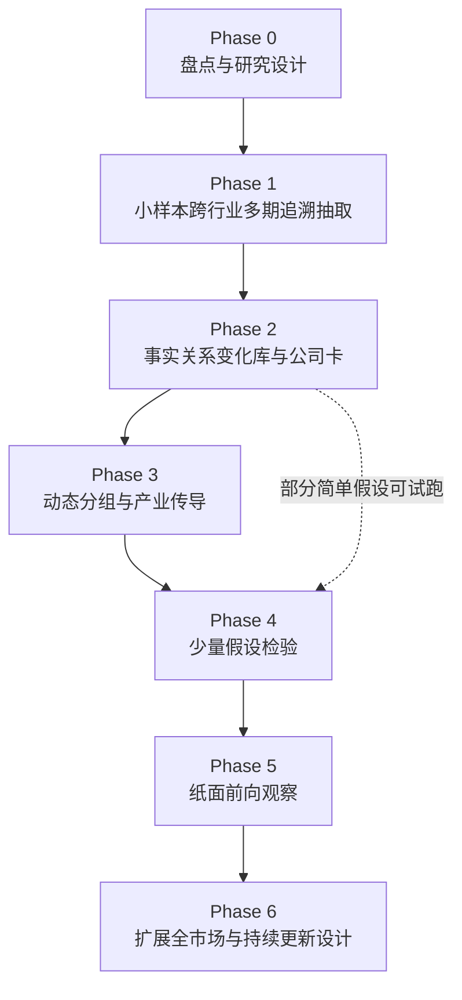

# 分期路线

路线只规定先后依赖、输入、输出和验收标准，不预先下日期，也不排工期。某一阶段被否决后，先补齐条件或收窄范围，不强行进入下一阶段。第六阶段只设计持续更新机制，不在本阶段创建例行化任务。

编号保持原蓝图的 Phase 0 到 Phase 6。状态截止 **2026-11-16，东京时间（UTC+9）**。下表是当时的状态记录，不是可以勾选的进度板。读者在页面上无法把这些项改成已完成。

总体约束见 [BLUEPRINT.md](BLUEPRINT.md)。架构、闭环和对象见 [ARCHITECTURE.md](ARCHITECTURE.md)。入口见 [README.md](README.md)。

## 阶段一览

| 阶段 | 名称 | 状态 | 先置依赖 |
|---|---|---|---|
| [Phase 0](#phase-0) | 盘点与研究设计 | 未开始 | 无 |
| [Phase 1](#phase-1) | 小样本跨行业多期追溯抽取 | 未开始 | Phase 0 |
| [Phase 2](#phase-2) | 事实关系变化库与公司卡 | 未开始 | Phase 1 |
| [Phase 3](#phase-3) | 动态分组与产业传导 | 未开始 | Phase 2 |
| [Phase 4](#phase-4) | 少量假设检验 | 未开始 | Phase 3；部分简单假设也可从 Phase 2 试跑 |
| [Phase 5](#phase-5) | 纸面前向观察 | 未开始 | Phase 4 |
| [Phase 6](#phase-6) | 扩展全市场与持续更新设计 | 未开始 | Phase 5 |

每阶段结束做 go / no-go。实线是先置依赖。虚线只表示：部分简单假设可以在 Phase 3 完成前从 Phase 2 试跑。Phase 4 的主路径仍然依赖 Phase 3。

## Phase 0　盘点与研究设计

状态：未开始。无先置依赖。

| 项 | 内容 |
|---|---|
| 输入 | 本地财报只读盘点、本蓝图 |
| 输出 | 格式、公告时间与结构化字段的覆盖情况、PIT 规则、假设试验预算与评价口径 |
| 验收 | 能如实说明缺什么，协议写清 |
| 否决 | 公告时间无法建立，或文件无法可靠解析 |

本阶段若启动，只做只读盘点，并另确认本项目的独立本地目录。盘点前已知的未核实线索见 [数据线索](BLUEPRINT.md#data-hints)。那些路径、库名和覆盖都还不是本阶段的验收结果。

## Phase 1　小样本跨行业多期追溯抽取

状态：未开始。依赖 Phase 0。

| 项 | 内容 |
|---|---|
| 输入 | 跨行业的少量公司、多期财报 |
| 输出 | 可回溯原文的事实与事件抽取、抽检记录 |
| 验收 | 每条记录有来源、时点和类型（声称、事实、推断）；人工抽检通过事先约定的标准 |
| 否决 | 证据无法回溯原文，或类型经常分不清 |

## Phase 2　事实关系变化库与公司卡

状态：未开始。依赖 Phase 1。

| 项 | 内容 |
|---|---|
| 输入 | Phase 1 抽取结果 |
| 输出 | 公司卡、逐期变化追踪、关系草稿 |
| 验收 | 能按 as-of 查询一家公司的事实与变化，结果可复现 |
| 否决 | 修订与真实经营变化无法区分 |

## Phase 3　动态分组与产业传导

状态：未开始。依赖 Phase 2。

| 项 | 内容 |
|---|---|
| 输入 | 事实关系库，官方行业仅作为视图之一 |
| 输出 | 多标签动态分组、暴露标签、传导链草图 |
| 验收 | 分组有明确规则和 as-of 快照，能历史回放 |
| 否决 | 分组使用了未来信息，或不能按时点回放 |

分组规则沿用总体蓝图：按共同客户类型、原材料、终端需求、商业模式和共同暴露来划，不只按官方行业标签。对象约束见 [数据对象与证据规则](ARCHITECTURE.md#schema)。

## Phase 4　少量假设检验

状态：未开始。依赖 Phase 3。部分简单假设也可从 Phase 2 试跑。

| 项 | 内容 |
|---|---|
| 输入 | 预注册且数量受预算约束的假设、历史数据 |
| 输出 | 试验记录、结果、反例，失败也保留 |
| 验收 | 每条假设先预注册；有时间切割或样本外；说明多重检验；不承诺收益 |
| 否决 | 独立样本不足，或无法保证 PIT |

本阶段检验的是预注册假设，不把演示样例升格为实证发现。相关不等于因果；没有识别策略和控制混杂时，只报告相关与时滞。经营变化为真，仍要单独检验定价是否已经反映。见 [研究问题](BLUEPRINT.md#questions) 与 [验证与风控](BLUEPRINT.md#validation)。

## Phase 5　纸面前向观察

状态：未开始。依赖 Phase 4。

| 项 | 内容 |
|---|---|
| 输入 | 仍存活的假设、新入财报 |
| 输出 | 结果揭晓前的观察记录、命中与失误、置信度校准 |
| 验收 | 观察先于结果记录，无前瞻污染 |
| 否决 | 无法在结果揭晓前记录观察，或出现前瞻污染 |

## Phase 6　扩展全市场与持续更新设计

状态：未开始。依赖 Phase 5。

| 项 | 内容 |
|---|---|
| 输入 | 全市场财报、Phase 5 协议 |
| 输出 | 扩展后的流水线、持续更新设计（不创建例行任务） |
| 验收 | 质量指标不较小样本明显下降，成本可承受，更新设计已写清 |
| 否决 | 扩大后质量明显下降，或成本不可持续 |

本阶段只设计持续更新机制。设计写清之前，不创建例行化任务，也不把扩展理解为已经获得自动交易或自动再训练的许可。
